# E03. Bastionado de Windows

_Módulo 5022. Bastionado de redes y sistemas_
_Hecho por Erjie Xia_
_16 de noviembre de 2026_

## Controles

1. **Versión y edición**: Get-ComputerInfo -Property OsName, OsVersion
2. **Contraseñas y bloqueo**: net accounts
3. **Cuentas locales**: Get-LocalUser | Format-Table Name, Enabled, PasswordExpires, LastLogon
4. **Quién es administrador**: Get-LocalGroupMember -SID S-1-5-32-544
    > Si da error: net localgroup Administradores (o Administrators si tu Windows está en inglés)
5. **Firewall por perfiles**: Get-NetFirewallProfile | Format-Table Name, Enabled, DefaultInboundAction
6. **RDP activado**: Get-ItemProperty 'HKLM:\SYSTEM\CurrentControlSet\Control\Terminal Server' -Name fDenyTSConnections
7. **RDP: NLA y TLS**: Get-ItemProperty 'HKLM:\SYSTEM\CurrentControlSet\Control\Terminal Server\WinStations\RDP-Tcp' -Name UserAuthentication, SecurityLayer
8. **SMBv1**: Get-SmbServerConfiguration | Select-Object EnableSMB1Protocol, EnableSMB2Protocol
9. **Auditoría**: auditpol /get /category:\*
10. **Servicios**: Get-Service RemoteRegistry, WinRM, TermService | Format-Table Name, Status, StartType
11. **Programas de inicio**: Get-CimInstance Win32_StartupCommand | Format-List Name, Command, Location
12. **Antivirus**: Get-MpComputerStatus | Format-List RealTimeProtectionEnabled, IsTamperProtected, AntivirusSignatureLastUpdated
13. **Cifrado de disco**: manage-bde -status C:

| Control                | Qué veo (img)                                                         | Valor seguro                                                                                                                | ¿Cumple? | Qué cambiaría |
| ---------------------- | --------------------------------------------------------------------- | --------------------------------------------------------------------------------------------------------------------------- | -------- | ------------- |
| Versión y edición      |                                 | (Sin valor de referencia) Versión con soporte y actualizada                                                                 |          |               |
| Contraseñas y bloqueo  | 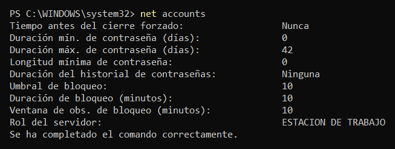                            | Longitud 14 o más · historial 24 · complejidad habilitada; umbral 5 o menos (nunca 0) · duración 15 min o más               |          |               |
| Cuentas locales        | 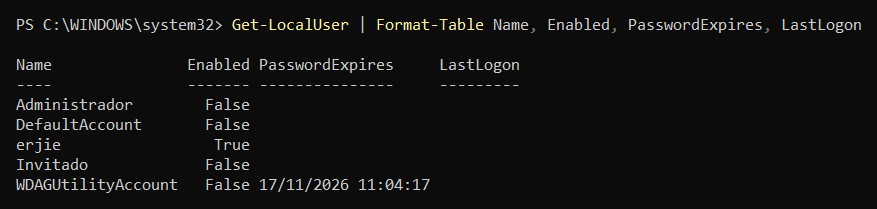                                  | Invitado deshabilitada · Administrador integrado deshabilitada o gestionada con LAPS                                        |          |               |
| Quién es administrador | 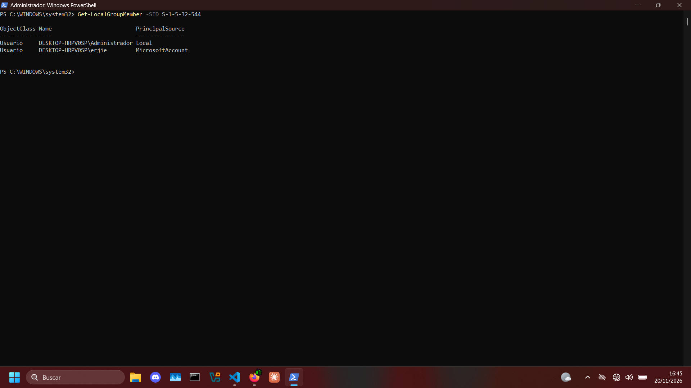                           | Cuenta de uso diario sin privilegios de administrador                                                                       |          |               |
| Firewall por perfiles  | 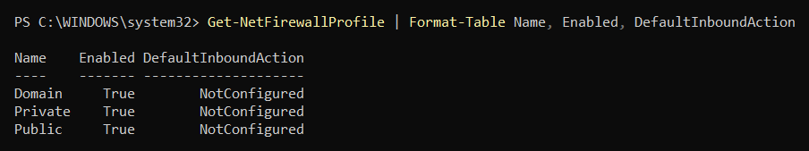                            | Los tres activados; entrada bloqueada por defecto                                                                           |          |               |
| RDP                    | 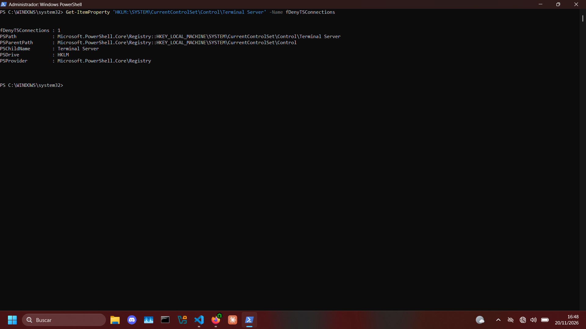 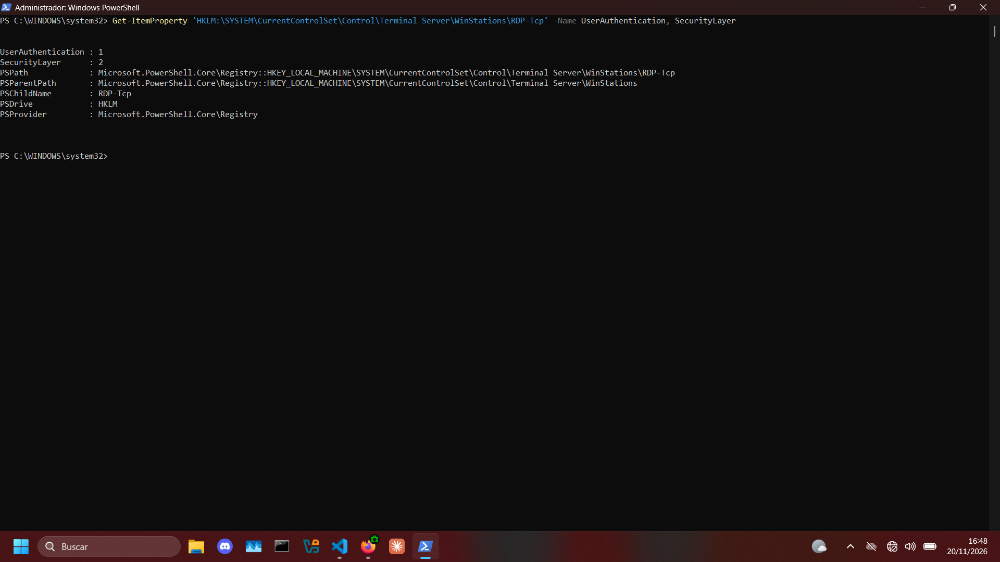 | `fDenyTSConnections` = 1 (desactivado) si no se usa · Si se usa: `UserAuthentication` = 1 (NLA) y `SecurityLayer` = 2 (TLS) |          |               |
| SMBv1                  | 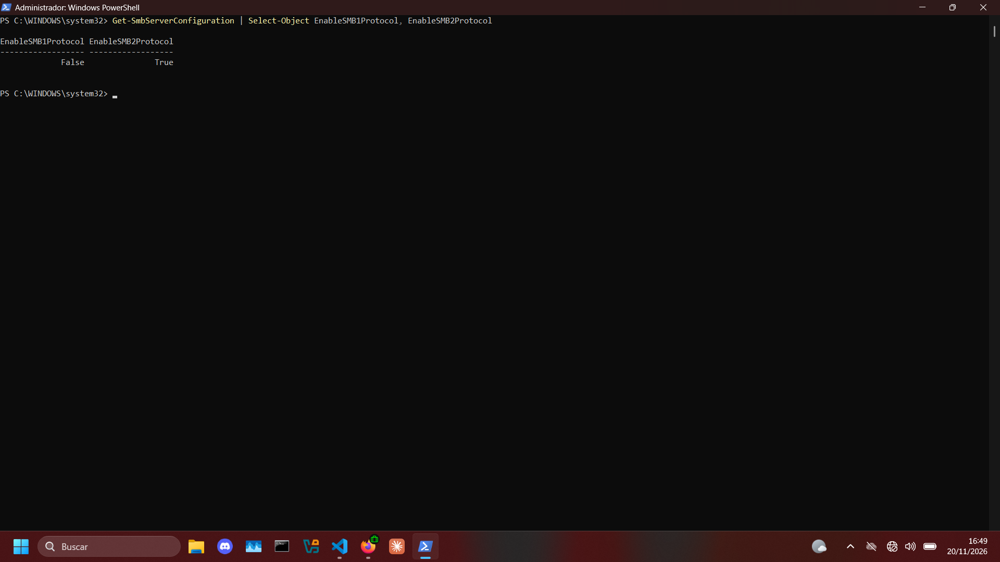                                            | False                                                                                                                       |          |               |
| Auditoría              | 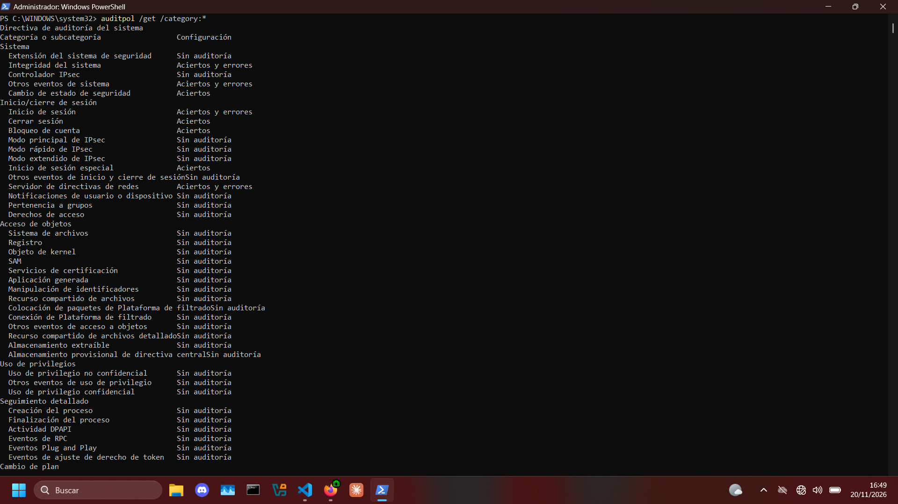 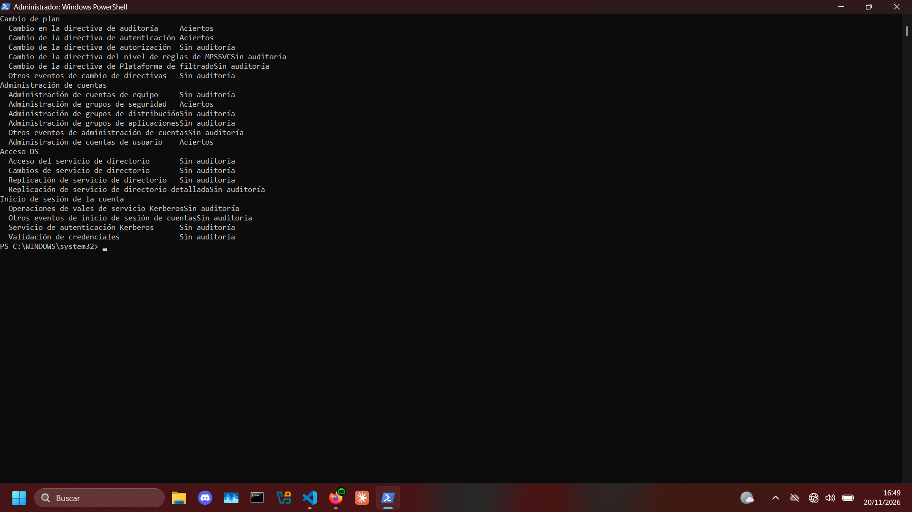     | Aciertos y errores · errores · aciertos y errores                                                                           |          |               |
| Servicios              | 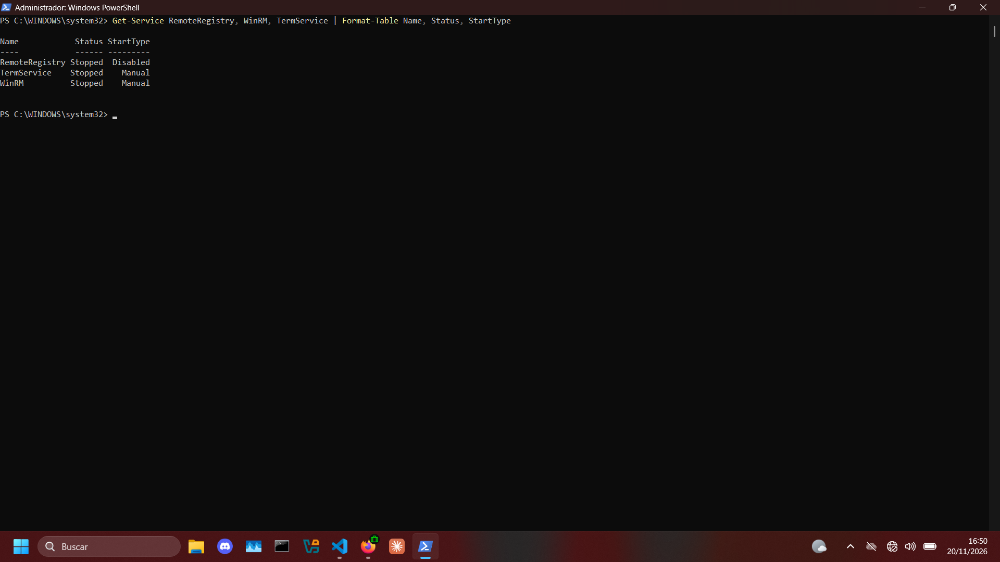                                        | Deshabilitados                                                                                                              |          |               |
| Programas de inicio    | 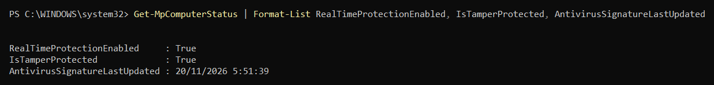                              | Solo software conocido, en rutas de programa (no en carpetas públicas ni temporales)                                        |          |               |
| Antivirus              | 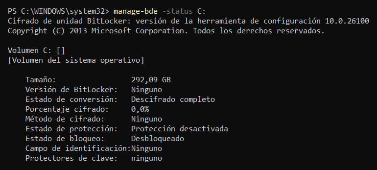                                        | Activado · activada · actualizadas                                                                                          |          |               |
| Cifrado de disco       | 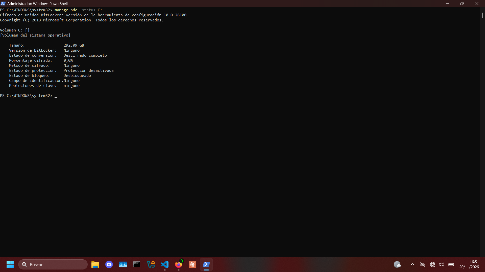                                 | Protection On                                                                                                               |          |               |

**Marcador** ¿cuántos de los 11 controles cumple tu equipo?
