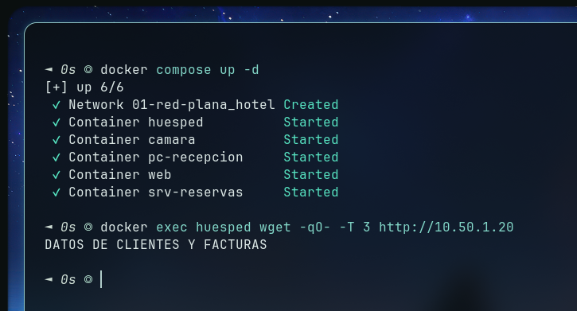
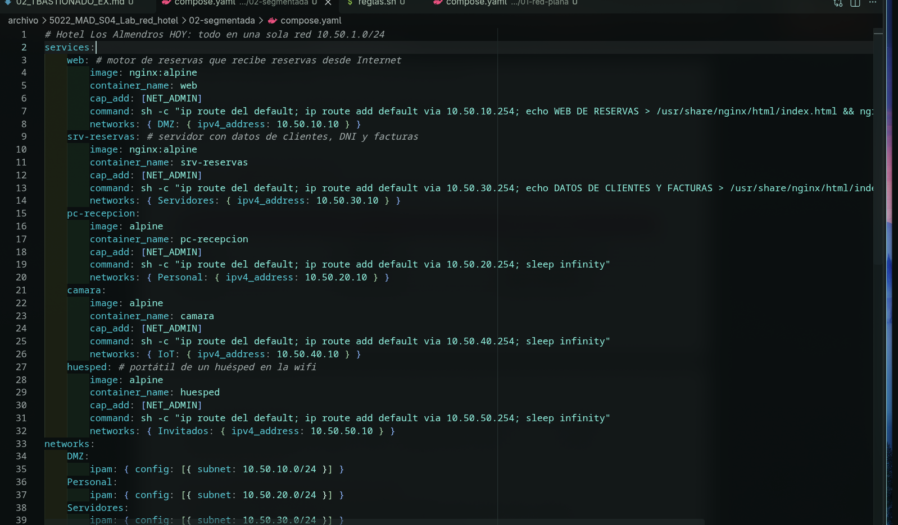
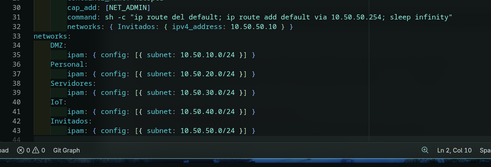
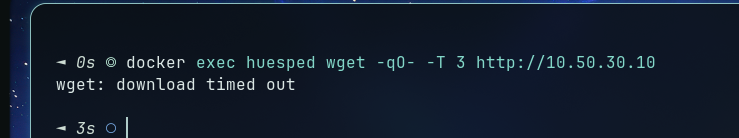

# 02 Subneting

## Paso 0

| Origen (zone) | Destino (equipo/zone) | Puerto | ¿Por qué hace falta?                                                                                                    |
| ------------- | --------------------- | ------ | ----------------------------------------------------------------------------------------------------------------------- |
| DMZ           | Servidores            | 80     | Para que las reservas que los clientes puedan realizar reservas desde la web                                            |
| Personal      | Servidores            | 80     | Para que el personal pueda revisar las reservas realizadas                                                              |
| Personal      | IoT                   | 80     | El personal podría querer acceder a las herramientas de IoT para usar la impresora o revisar lo ocurrido en las cámaras |
| Personal      | DMZ                   | 80     | El personal podría buscar información en la web para informar a los clientes                                            |
| Inv1tados     | DMZ                   | 80     | Los clientes podrían querer ver la página web para descubrir el hotel                                                   |

## Paso 1

¿Qué acaba de ver el huésped? ¿Qué más podría alcanzar?
El huésped acaba de recoger los datos de ordenador "srv-reservas", con datos importantes de clientes. Es capaz de alcanzar a todos ordenadores que se encuentren en la red.

## Paso 2

Comprobad que el huésped ya NO llega al servidor.

¿Y recepción llega a reservas?¿Por qué?
No llega, porque están aislados en grupos sin conexión entre ellos.

## Paso 3

## Paso 4

| Desde        | Hacia           | ¿Debe pasar? | ¿Pasa? |
| ------------ | --------------- | ------------ | ------ |
| huesped      | srv-reservas:80 | No           | No     |
| huesped      | web:80          | Sí           | Sí     |
| pc-recepcion | srv-reservas:80 | Sí           | Sí     |
| pc-recepcion | web:80          | Sí           | Sí     |
| web          | srv-reservas:80 | Sí           | Sí     |
| camara       | srv-reservas:80 | No           | No     |
