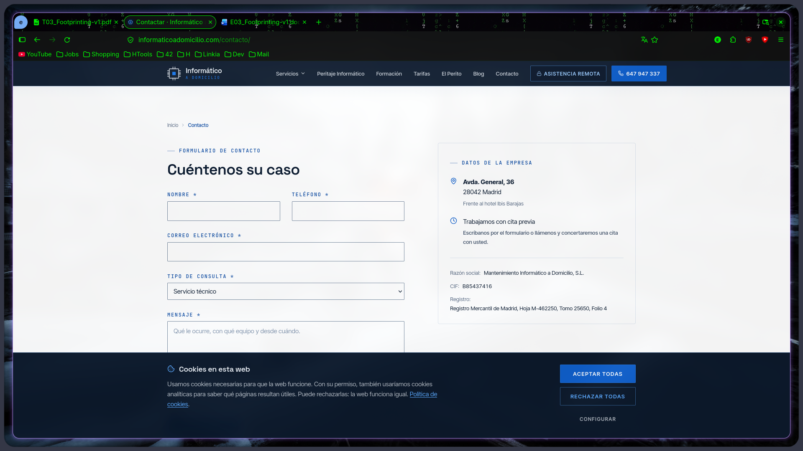

# Tema 03. Footprinting

_Módulo 5025. Hacking Ético_
_Hecho por Erjie Xia_
_18 de noviembre de 2026_

## 1. Seleccionar y registrar el objetivo

- Dominio seleccionado: [informaticoadomicilio.com](https://informaticoadomicilio.com/)
- Motivo de la elección: Es la página web de un conocido.
- Fecha y hora: 11 de noviembre de 2026, a las horas 8:47
- Preguntas que quieres responder: ¿Cuánta información privada se podrá encontrar?

## 2. Observar el sitio

- URL inicial y final

[Url inicial](https://informaticoadomicilio.com/)
[Url final](https://informaticoadomicilio.com/contacto/)

- Finalidad aparente del sitio: Es una web corporativa, su finalidad es presentar la empresa.
- Funciones visibles: Servicio de mail.
- Enlaces a servicios externos:

[Google maps](https://www.google.com/maps/dir/?api=1&destination=Avda.%20General%2C%2036%2C%2028042%20Madrid)
[www.peritostecnologicos.es](https://www.peritostecnologicos.es/)
[www.linkedin.com](https://www.linkedin.com/company/mantenimiento-informatico-a-domicilio-sl)
[twitter.com](https://twitter.com/soyinformatico)

Es una página web corporativa cuya finalidad es presentar la empresa. Cuenta con un servicio de mensajería. Además, tiene enlaces a servicios externos: google maps, peritostecnologicos, linkedin, y X (twitter).

## 3. Consultar DNS

| Duda                          | Comando                     | Respuesta                                                                                                                                                                                            | Interpretación                                                                                                                                                                                                                                     |
| ----------------------------- | --------------------------- | ---------------------------------------------------------------------------------------------------------------------------------------------------------------------------------------------------- | -------------------------------------------------------------------------------------------------------------------------------------------------------------------------------------------------------------------------------------------------- |
| ¿Qué IPv4 publica?            | dig ejemplo.com A           | 75.2.60.5                                                                                                                                                                                            | La web apunta a una IP de Netlify. Es una IP compartida por muchas webs, así que no identifica un servidor propio.                                                                                                                                 |
| ¿Qué IPv6 publica?            | dig ejemplo.com AAAA        | Sin respuesta                                                                                                                                                                                        | NOERROR sin el registro: el nombre existe pero no publica IPv6. Solo se llega a la web por IPv4.                                                                                                                                                   |
| ¿Qué servidores DNS declara?  | dig ejemplo.com NS          | ns4.cdmondns-01.org. \ ns5.cdmondns-01.com. \ ns3.cdmon.net. \ ns1.cdmon.net. \ ns2.cdmon.net.                                                                                                       | El DNS lo gestiona cdmon, con cinco servidores repartidos en tres dominios distintos para tener redundancia. Coinciden con los del WHOIS.                                                                                                          |
| ¿Dónde recibe correo?         | dig ejemplo.com MX          | 10 mail.informaticoadomicilio.com.                                                                                                                                                                   | El correo llega a un servidor propio del dominio. Resuelve a 134.0.12.107, que según RIPE es de cdmon, no de Netlify: la web y el correo están en proveedores distintos.                                                                           |
| ¿Qué información TXT publica? | dig ejemplo.com TXT         | bd5MKJfGDWFCTP5_Sb3f-DpyHC0D7JjHCfOnVk7r30E \ o7g41q07uT4QtKB776131DGo2czi5Wys4EdyufPew6s \ google-site-verification=fufzpwBaJz7ujS97WDvsOb7ehksD2pPsyYmX7aT2S1Y \ v=spf1 include:\_spf.srv.cat ~all | Hay dos tokens de verificación de algún servicio sin identificar, una verificación de Google Search Console y un SPF: solo deben enviar correo los servidores de `_spf.srv.cat`. Con `~all`, el resto se marca como sospechoso pero no se rechaza. |
| ¿Qué política CAA publica?    | dig ejemplo.com CAA         | ns1.cdmon.net. hostmaster.informaticoadomicilio.com. 1 10800 3600 604800 3600                                                                                                                        | NOERROR sin CAA: esa línea es el SOA de la sección AUTHORITY, no una respuesta. No hay política CAA, así que cualquier CA puede emitir certificados para el dominio.                                                                               |
| ¿www es un alias?             | dig <www.ejemplo.com> CNAME | ns1.cdmon.net. hostmaster.informaticoadomicilio.com. 1 10800 3600 604800 3600                                                                                                                        | NOERROR sin CNAME (otra vez el SOA): `www` no es un alias, tiene su propio registro A.                                                                                                                                                             |
| ¿Qué IPv4 devuelve www?       | dig <www.ejemplo.com> A     | 75.2.60.5                                                                                                                                                                                            | Es la misma IP que el dominio raíz. Netlify distingue los dos nombres por la cabecera `Host` y el SNI, y redirige `www` al raíz (apartado 6).                                                                                                      |

## 4. Consultar información registral

- Registrador: 10dencehispahard SLU
- Fechas:
  Fecha de actualización: 2026-06-30T02:24:32Z
  Fecha de creación: 2003-07-14T16:13:40Z
  Fecha de expiración: 2027-07-14T16:13:40Z
- Estados: ok <https://icann.org/epp#ok>
- Servidores de nombres:
  Name Server: NS1.CDMON.NET
  Name Server: NS2.CDMON.NET
  Name Server: NS3.CDMON.NET
  Name Server: NS4.CDMONDNS-01.ORG
  Name Server: NS5.CDMONDNS-01.COM

**Fuente:** consulta WHOIS del registro `informaticoadomicilio.com`. **Fecha de consulta:** 20 de noviembre de 2026.

**Resumen:** el dominio está registrado desde julio de 2003 a través de 10dencehispahard SLU, la empresa que hay detrás de cdmon. Es un dominio antiguo y estable. Su estado es `ok`: no está bloqueado ni en ningún trámite (transferencia, borrado o suspensión). La última actualización fue el 30/06/2026 y caduca el 14/07/2027. Los cinco servidores de nombres coinciden con los del registro NS del apartado 3, así que el registro y el DNS son coherentes.

El registro y el DNS están en cdmon, pero la web está en Netlify (apartados 3 y 6): **gestionar el dominio y alojar la web son dos cosas distintas**. El WHOIS no muestra los datos del titular, y no se debe tomar el contacto del registrador por el propietario del sitio.

## 5. Identificar indicios tecnológicos

| Tecnología aparente                       | Evidencia                                          | Confianza y limitaciones                                                                                            |
| ----------------------------------------- | -------------------------------------------------- | ------------------------------------------------------------------------------------------------------------------- |
| React                                     | Muchos menciones de React en varios ficheros js    | Es poco posible que el desarrollador use nombres de variables, pero no imposible                                    |
| Vite                                      | Carpetas, nombres de hashes, división por chunks   | Es poco posible que el desarrollador los haya organizado así a drede, pero no imposible                             |
| Tailwindcss v4.3.3                        | Comentario en el contenido de fichero css          | Un comentario no es una aseguradora, pero si un indicio                                                             |
| Netlify                                   | En el CSP (Content security policy en la cabecera) | El CSP es una whitelist de scripts en la página web, es posible que el desarrollador los añada sin usar el servicio |
| Supabase                                  | En el CSP                                          | ...                                                                                                                 |
| Cloudflare                                | En el CSP                                          | ...                                                                                                                 |
| Google analytics                          | En el CSP                                          | ...                                                                                                                 |
| Vimeo                                     | En el CSP                                          | ...                                                                                                                 |
| Google maps                               | En el CSP                                          | ...                                                                                                                 |
| Youtube                                   | En el CSP                                          | ...                                                                                                                 |
| Nanosystems (Supremo - escritorio remoto) | En el CSP                                          | Está añadido, pero en solamente existe la mención del servicio para sistemas MAC                                    |

## 6. Observar HTTP y redirecciones

Entrega: URL solicitada, estado, destino y observaciones. No es necesario puntuar la seguridad de las cabeceras.

URL solicitada: <https://informaticoadomicilio.com/>
Estado: 304 (cargado del cache)
Destino: sin redirecciones, pero <https://www.informaticoadomicilio.com/> si redirige a <https://informaticoadomicilio.com/>
Observaciones: Ninguna

## 7. Observar el certificado

- Nombres cubiertos: <informaticoadomicilio.com> y <www.informaticoadomicilio.com>
- Emisor: <Let's Encrypt>
- Inicio y fin de vigencia:
  Inicio de vigencia: Viernes, 30 de octubre de 2026 a las 07:03:46 GMT
  Fin de vigencia: Jueves, 28 de enero de 2027 a las 07:03:45 GMT
- Advertencias: Ninguna

## 8. Construir el inventario

**Inventario de informaticoadomicilio.com:**

| Elemento             | Fuente                     | Resultado observado                                                        | Interpretación                                                                 | Pendiente                                                                                |
| -------------------- | -------------------------- | -------------------------------------------------------------------------- | ------------------------------------------------------------------------------ | ---------------------------------------------------------------------------------------- |
| Dominio              | DNS (A, AAAA)              | A: 75.2.60.5; sin AAAA                                                     | La web se publica en la red de Netlify, solo por IPv4                          | Si hay otras webs o subdominios del mismo dueño (no se pueden enumerar en esta práctica) |
| www                  | DNS (CNAME, A) y HTTP      | Sin CNAME; A: 75.2.60.5; `301` → `https://informaticoadomicilio.com/`      | `www` es un nombre secundario que redirige al dominio principal                | Ninguno relevante                                                                        |
| DNS                  | Registros NS y WHOIS       | ns1, ns2 y ns3.cdmon.net, ns4.cdmondns-01.org, ns5.cdmondns-01.com         | El DNS depende de cdmon; NS y WHOIS coinciden                                  | Si la zona tiene DNSSEC (no se ha consultado)                                            |
| Registro             | WHOIS                      | 10dencehispahard SLU; creado en 2003; estado `ok`; caduca en 2027-07       | Dominio antiguo y activo, gestionado en cdmon                                  | El titular real (el WHOIS no lo muestra)                                                 |
| Correo               | Registro MX y RDAP de RIPE | `mail.informaticoadomicilio.com` → 134.0.12.107 (red de cdmon)             | El correo se recibe en cdmon, separado de la web                               | Qué software de correo usa; si tiene DMARC (no se ha consultado)                         |
| Envío de correo      | Registro TXT (SPF)         | `v=spf1 include:_spf.srv.cat ~all`                                         | Solo los servidores de `srv.cat` deberían enviar en su nombre                  | Si `~all` (no rechaza) es una decisión consciente                                        |
| Verificaciones       | Registro TXT               | `google-site-verification` y dos tokens sin prefijo                        | El dominio está dado de alta en Google Search Console y en algún otro servicio | A qué servicio pertenecen los dos tokens                                                 |
| Certificado          | Visor del navegador        | Let's Encrypt (YE1), SAN con el raíz y `www`, del 30/10/2026 al 28/01/2027 | Certificado DV válido, renovado automáticamente                                | Qué versiones y cifrados TLS acepta, no solo el que se negoció                           |
| Política CAA         | Registro CAA               | NOERROR sin registro                                                       | No limita qué CA puede emitir certificados                                     | Ninguno: es un hecho, no una hipótesis                                                   |
| Tecnología: hosting  | Cabeceras HTTP             | `server: Netlify`, `x-nf-request-id`                                       | La web está alojada en Netlify                                                 | Ninguna: la IP y las cabeceras coinciden                                                 |
| Tecnología: frontend | Recursos JS y CSS          | React, Vite (chunks con hash), comentario de Tailwind v4.3.3               | Web hecha con React, compilada con Vite y generada estáticamente               | Las versiones exactas de los paquetes                                                    |
| Tecnología: backend  | Cabecera CSP               | `*.supabase.co` en `connect-src`                                           | Los datos dinámicos (blog, panel) probablemente vienen de Supabase             | Qué datos guarda y si la API exige autenticación                                         |
| Tecnología: terceros | Cabecera CSP               | Cloudflare, Google Analytics, Vimeo, Google Maps, YouTube, NanoSystems     | Servicios externos que la web puede cargar                                     | Si todos se usan de verdad (NanoSystems aparece en la CSP sin uso visible)               |

## 9. Redactar las conclusiones

### Cinco hechos respaldados por evidencias

**1. La web está alojada en Netlify.**

- Qué hice: consulté el registro A con `dig` y revisé las cabeceras de respuesta en el panel Red.
- Por qué: quería saber dónde se sirve la web.
- Qué observé: la IP es 75.2.60.5 y las cabeceras incluyen `server: Netlify` y `x-nf-request-id`.
- Qué significa: el sitio usa la infraestructura compartida de Netlify, no un servidor propio.
- Qué no demuestra: dónde están los datos dinámicos (todo apunta a Supabase) ni quién es el propietario. La IP es compartida con otras webs.

**2. `www` es un nombre secundario que redirige al dominio principal.**

- Qué hice: consulté `CNAME` y `A` de `www` y pedí `https://www.informaticoadomicilio.com/`.
- Por qué: quería saber si los dos nombres son la misma web.
- Qué observé: `www` no tiene CNAME, tiene la misma IP que el raíz y responde con un `301` hacia `https://informaticoadomicilio.com/`.
- Qué significa: el dominio sin `www` es el principal. El servidor distingue los dos nombres por `Host` y SNI.
- Qué no demuestra: cómo responden otros subdominios que no se han consultado.

**3. El registro y el DNS del dominio están en cdmon.**

- Qué hice: consulté el WHOIS y el registro NS.
- Por qué: quería contrastar la gestión del dominio con los servidores DNS.
- Qué observé: el registrador es 10dencehispahard SLU (cdmon), el dominio existe desde 2003 y los cinco NS son de cdmon en los dos casos.
- Qué significa: el dominio se gestiona en un proveedor y la web se aloja en otro.
- Qué no demuestra: quién es el titular del dominio ni quién administra la cuenta en cdmon.

**4. El correo está separado de la web.**

- Qué hice: consulté el MX y el TXT, resolví `mail.informaticoadomicilio.com` y busqué esa IP en RDAP de RIPE.
- Por qué: quería saber dónde recibe y desde dónde envía correo.
- Qué observé: el MX apunta a `mail.informaticoadomicilio.com` (134.0.12.107, red de cdmon) y el SPF autoriza `_spf.srv.cat` con `~all`.
- Qué significa: el correo depende de cdmon, no de Netlify, y el SPF no rechaza a los remitentes no autorizados, solo los marca.
- Qué no demuestra: si el servidor de correo es seguro, qué software usa ni si existe una política DMARC.

**5. HTTPS usa un certificado válido de Let's Encrypt.**

- Qué hice: abrí el visor de certificados del navegador.
- Por qué: quería ver la identidad que presenta el sitio en HTTPS.
- Qué observé: emisor Let's Encrypt (YE1), SAN con `informaticoadomicilio.com` y `www.informaticoadomicilio.com`, vigencia del 30/10/2026 al 28/01/2027 y ninguna advertencia.
- Qué significa: la conexión está cifrada y el navegador valida el dominio. Es un certificado DV de 90 días con renovación automática.
- Qué no demuestra: que toda la configuración TLS sea segura ni que la web no tenga vulnerabilidades. Un certificado DV tampoco acredita a la empresa, solo el control del dominio.

### Tres cuestiones que no he podido determinar

1. **A qué servicio corresponden los dos registros TXT sin prefijo.** Parecen tokens de verificación, pero no dicen de qué proveedor son y no hay más pistas en la consulta.
2. **Si existen más subdominios o servicios del mismo dominio.** Solo he consultado el raíz, `www` y `mail`. Descubrir el resto requeriría enumerar subdominios, lo que está fuera de los límites de esta práctica.
3. **Si el backend (Supabase) protege bien los datos.** La CSP muestra que la web se conecta a Supabase y hay indicios de un panel de administración, pero observando no se puede saber si la API exige autenticación.

En cuanto a la pregunta del apartado 1 (¿cuánta información privada se podrá encontrar?): con métodos pasivos solo aparece lo que la empresa publica (proveedores, dirección comercial y redes sociales). No ha aparecido información privada.

### Dos comprobaciones para una auditoría autorizada posterior

**1. Autorización en el servidor (Supabase y panel de administración).**

- Qué haría: comprobar que sin sesión de administrador la API no permite leer ni modificar datos (políticas RLS y roles), que la contraseña de asistencia remota tiene límite de intentos y que su caducidad se controla en el servidor.
- Por qué: la CSP incluye `*.supabase.co` y el código público tiene un módulo `Admin` y de asistencia remota.
- Qué no demuestra el footprinting: que exista el código del panel no dice si la API está protegida. Eso solo se puede probar con autorización.

**2. Configuración completa de TLS, CSP y correo.**

- Qué haría: revisar con `testssl.sh` todas las versiones y cifrados que acepta el servidor, analizar la CSP con CSP Evaluator y revisar SPF y DMARC del correo.
- Por qué: solo he visto la versión TLS negociada, la CSP permite `www.googletagmanager.com` en `script-src` (un _bypass_ conocido) y el SPF usa `~all`.
- Qué no demuestra el footprinting: una CSP permisiva o un SPF suave no son una vulnerabilidad por sí solos. Hacen falta una inyección previa o un intento de suplantación para que se aprovechen.
