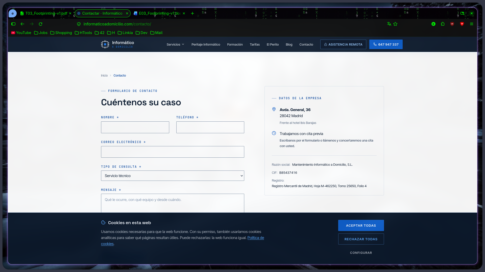

# Tema 03. Footprinting

_Módulo 5025. Hacking Ético_
_Hecho por Erjie Xia_
_18 de noviembre de 2026_

## 1. Seleccionar y registrar el objetivo

- Dominio seleccionado: [informaticoadomicilio.com](https://informaticoadomicilio.com/)
- Motivo de la elección: Es la página web de un conocido.
- Fecha y hora: 11 de noviembre de 2026, a las horas 8:47
- Preguntas que quieres responder: ¿Cuánta información privada se podrá encontrar?

## 2. Observar el sitio

- URL inicial y final

[Url inicial](https://informaticoadomicilio.com/)
[Url final](https://informaticoadomicilio.com/contacto/)

- Finalidad aparente del sitio: Es una web corporativa, su finalidad es presentar la empresa.
- Funciones visibles: Servicio de mail.
- Enlaces a servicios externos:

[Google maps](https://www.google.com/maps/dir/?api=1&destination=Avda.%20General%2C%2036%2C%2028042%20Madrid)
[www.peritostecnologicos.es](https://www.peritostecnologicos.es/)
[www.linkedin.com](https://www.linkedin.com/company/mantenimiento-informatico-a-domicilio-sl)
[twitter.com](https://twitter.com/soyinformatico)

Es una página web corporativa cuya finalidad es presentar la empresa. Cuenta con un servicio de mensajería. Además, tiene enlaces a servicios externos: google maps, peritostecnologicos, linkedin, y X (twitter).

Entrega: una captura y un párrafo explicativo.

TODO ## 3. Consultar DNS

| Duda                          | Comando                     | Respuesta | Interpretación |
| ----------------------------- | --------------------------- | --------- | -------------- |
| ¿Qué IPv4 publica?            | dig ejemplo.com A           |           |                |
| ¿Qué IPv6 publica?            | dig ejemplo.com AAAA        |           |                |
| ¿Qué servidores DNS declara?  | dig ejemplo.com NS          |           |                |
| ¿Dónde recibe correo?         | dig ejemplo.com MX          |           |                |
| ¿Qué información TXT publica? | dig ejemplo.com TXT         |           |                |
| ¿Qué política CAA publica?    | dig ejemplo.com CAA         |           |                |
| ¿www es un alias?             | dig <www.ejemplo.com> CNAME |           |                |
| ¿Qué IPv4 devuelve www?       | dig <www.ejemplo.com> A     |           |                |

??
Busca status y ANSWER SECTION. Distingue:
• NXDOMAIN: el nombre consultado no existe según esa respuesta.
• NOERROR sin el registro solicitado: la consulta se resolvió, pero no
obtuvo ese tipo de registro.
• Tiempo de espera: no se recibió respuesta; no demuestra que el
nombre no exista.
Entrega: tabla con consulta, resultado e interpretación.
??

TODO ## 4. Consultar información registral

Herramienta: WHOIS
Busca el dominio y registra:

- Registrador:
- Fechas:
- Estados:
- Servidores de nombres:

Entrega: resumen con fuente y fecha de consulta.

## 5. Identificar indicios tecnológicos

| Tecnología aparente                       | Evidencia                                          | Confianza y limitaciones                                                                                            |
| ----------------------------------------- | -------------------------------------------------- | ------------------------------------------------------------------------------------------------------------------- |
| React                                     | Muchos menciones de React en varios ficheros js    | Es poco posible que el desarrollador use nombres de variables, pero no imposible                                    |
| Vite                                      | Carpetas, nombres de hashes, división por chunks   | Es poco posible que el desarrollador los haya organizado así a drede, pero no imposible                             |
| Tailwindcss v4.3.3                        | Comentario en el contenido de fichero css          | Un comentario no es una aseguradora, pero si un indicio                                                             |
| Netlify                                   | En el CSP (Content security policy en la cabecera) | El CSP es una whitelist de scripts en la página web, es posible que el desarrollador los añada sin usar el servicio |
| Supabase                                  | En el CSP                                          | ...                                                                                                                 |
| Cloudflare                                | En el CSP                                          | ...                                                                                                                 |
| Google analytics                          | En el CSP                                          | ...                                                                                                                 |
| Vimeo                                     | En el CSP                                          | ...                                                                                                                 |
| Google maps                               | En el CSP                                          | ...                                                                                                                 |
| Youtube                                   | En el CSP                                          | ...                                                                                                                 |
| Nanosystems (Supremo - escritorio remoto) | En el CSP                                          | Está añadido, pero en solamente existe la mención del servicio para sistemas MAC                                    |

## 6. Observar HTTP y redirecciones

Herramienta preferida: panel Red de Firefox.

1. Activa Conservar registro.
2. Visita <http://ejemplo.com>
3. Observa los estados y destinos de las redirecciones.
4. Selecciona la petición del documento final.
5. Revisa sus cabeceras de respuesta.

Entrega: URL solicitada, estado, destino y observaciones. No es necesario puntuar la seguridad de las cabeceras.

URL solicitada: <https://informaticoadomicilio.com/>
Estado: 304 (cargado del cache)
Destino: sin redirecciones, pero <https://www.informaticoadomicilio.com/> si redirige a <https://informaticoadomicilio.com/>
Observaciones: // ?? que observar

## 7. Observar el certificado

- Nombres cubiertos: <informaticoadomicilio.com> y <www.informaticoadomicilio.com>
- Emisor: <Let's Encrypt>
- Inicio y fin de vigencia:
  Inicio de vigencia: Viernes, 30 de octubre de 2026 a las 07:03:46 GMT
  Fin de vigencia: Jueves, 28 de enero de 2027 a las 07:03:45 GMT
- Advertencias: Ninguna

TODO ## 8. Construir el inventario

Herramientas: LibreOffice Calc, Writer o editor de texto.

Consolida los datos:

| Elemento   | Fuente       | Resultado observado | Interpretación        | Pendiente              |
| ---------- | ------------ | ------------------- | --------------------- | ---------------------- |
| Dominio    | DNS          | Respuesta obtenida  | Destino publicado     | Lo que falta confirmar |
| DNS        | Registros NS | Nombres declarados  | Dependencia observada | Lo que falta confirmar |
| Correo     | Registro MX  | Destino publicado   | Recepción de correo   | Lo que falta confirmar |
| Tecnología | Navegador    | Indicio encontrado  | Hipótesis             | Confirmación necesaria |

TODO ## 9. Redactar las conclusiones

- Cinco hechos respaldados por evidencias.
- Tres cuestiones que no has podido determinar.
- Dos comprobaciones que propondrías para una auditoría autorizada posterior.

Para cada prueba explica:
Qué hice, por qué lo hice, qué observé, qué significa y qué no demuestra.
