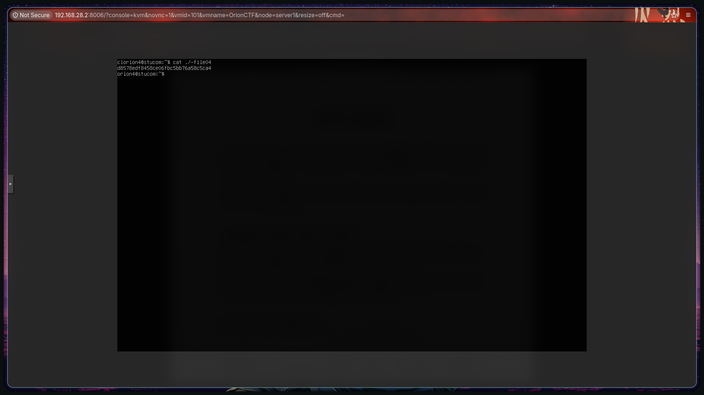
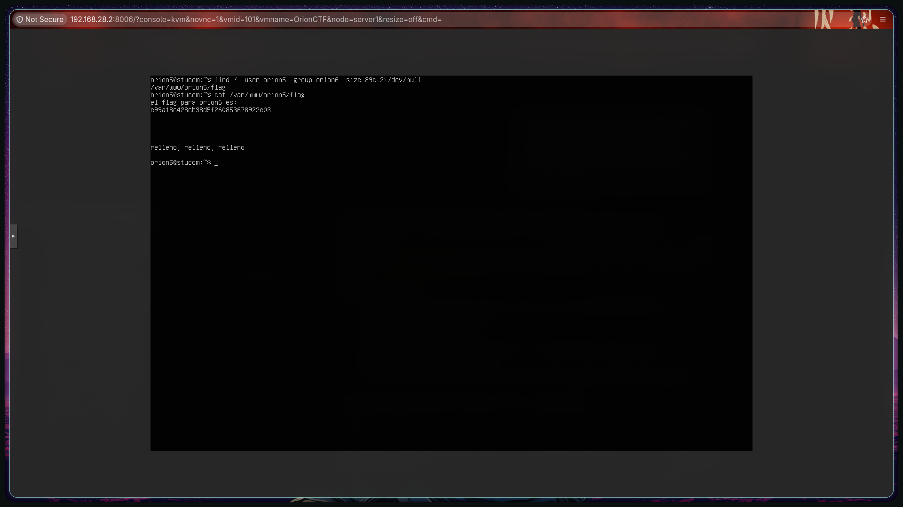
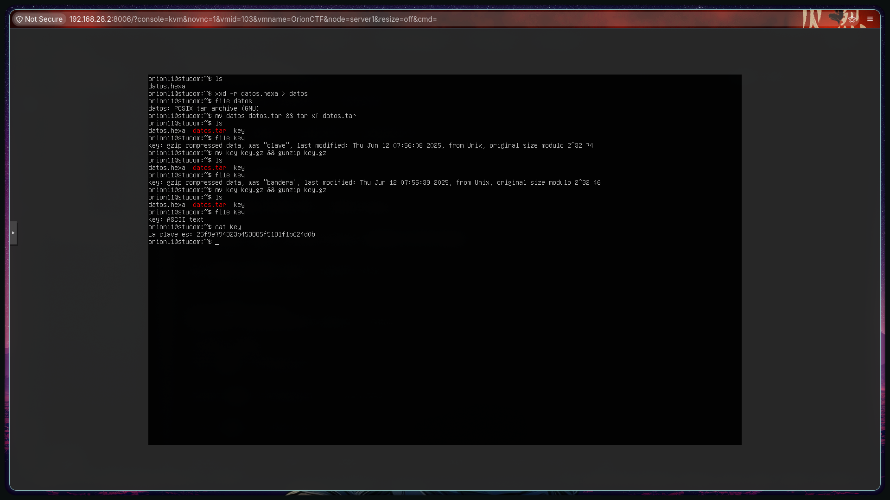
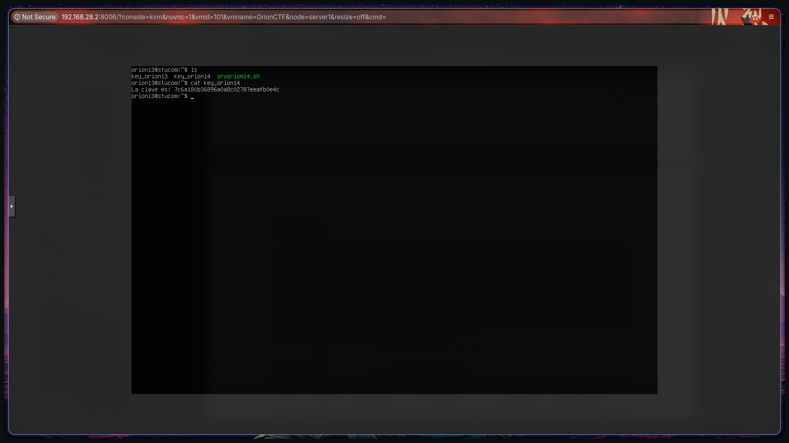

# 02_THLINUXSH

## Description

### Flag 1

### Flag 2

### Flag 3

### Flag 4

### Flag 5

### Flag 6

### Flag 7

### Flag 8

### Flag 9

### Flag 10

### Flag 11

### Flag 12

### Flag 13

### Flag 14

> Esta máquina está mal. Nada más entrar en el directorio /home del usuarion orion13, se puede encontrar la clave de orion14 sin tener que realizar ninguna tarea

### Flag 15

### Flag 16

### Flag 17

### Flag 18

### Flag 19

