# 02_THLINUXSH

## Description

En esta tarea se busca lograr un nivel básico de conocimientos sobre bash. Para ello se utilizará una máquina virtual configurada con usuarios orion0, orion1, orion2..., hasta orion 16. El objetivo es llegar al usuario orion16. Para ello se debe iniciar sesión en orion0 con la contraseña 'orion0' y buscar la contraseña del siguiente usuario, orion1; la contraseña de orion2 se encontrará en orion1; y de esta forma sucesiva hasta orion16.

> Existe una hoja de ayuda para comandos linux y otro con enunciados para cada usuario como guía para hallar la contraseña del siguiente orion.

### Flag 1

El primer flag se encuentra en el `fichero 'flag1'` del directorio `/home` del usuario. Los pasos para encontrarlo son:

1. Acceder al directorio home. Para ello se puede usar el comando 'cd' e indicando la ruta al directorio (/home o '~'). `cd ~`
2. Listar los objetos del directorio actual y podemos encontrarnos con 'flag1'. Con el comando 'ls' listamos los objetos del directorio. `ls`
3. Extraer el contenido del fichero flag. Con el comando cat podemos extraer y leer el contenido de muchos ficheros. `cat flag1`

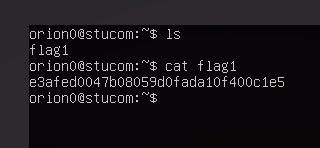

### Flag 2

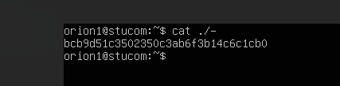

### Flag 3

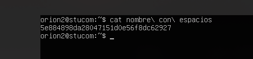

### Flag 4

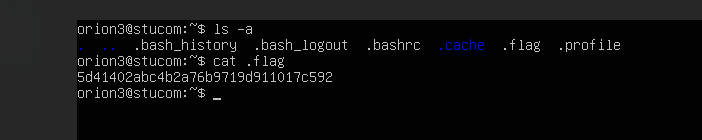

### Flag 5

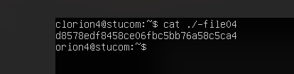

### Flag 6

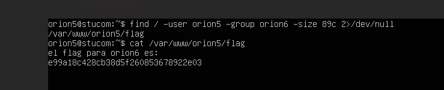

### Flag 7

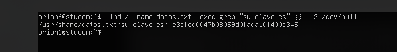

### Flag 8

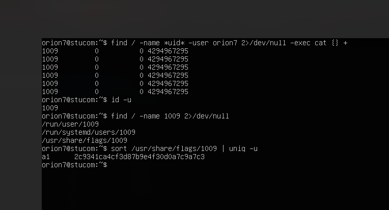

### Flag 9

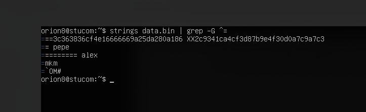

### Flag 10

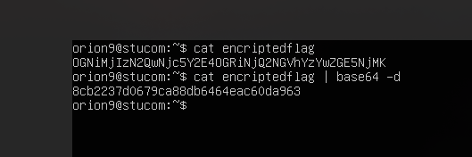

### Flag 11

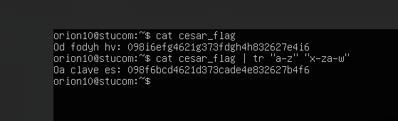

### Flag 12

### Flag 13

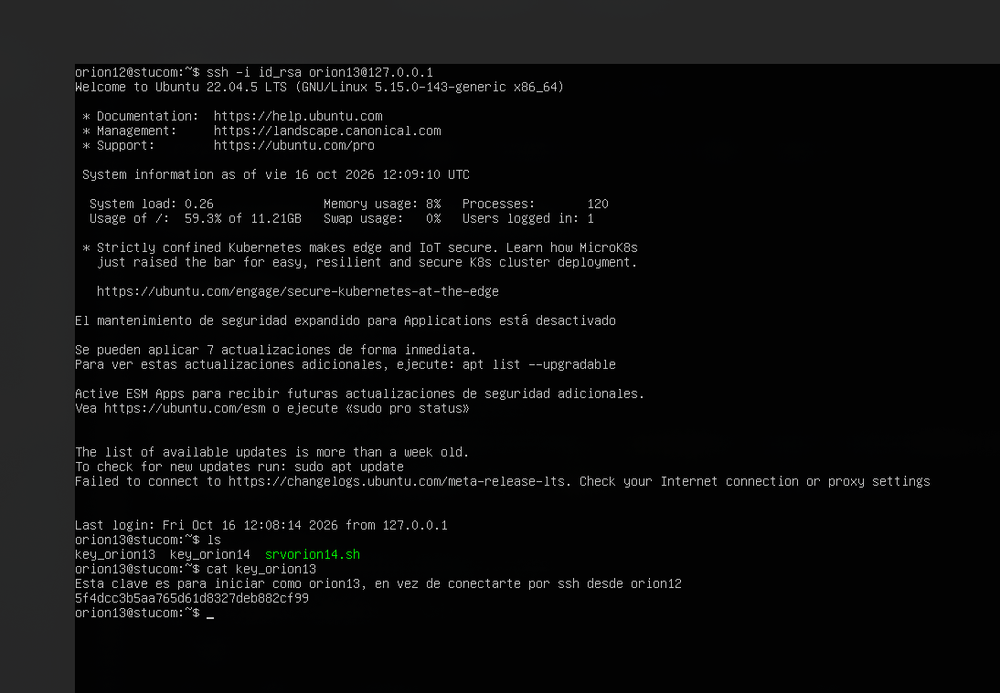

### Flag 14

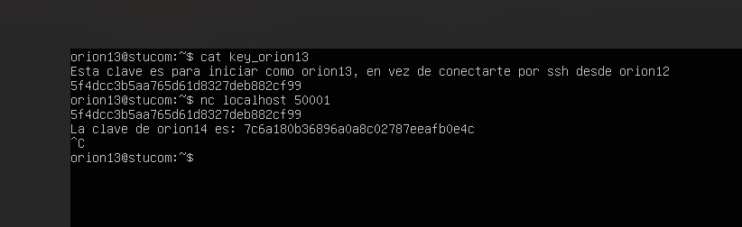

### Flag 15

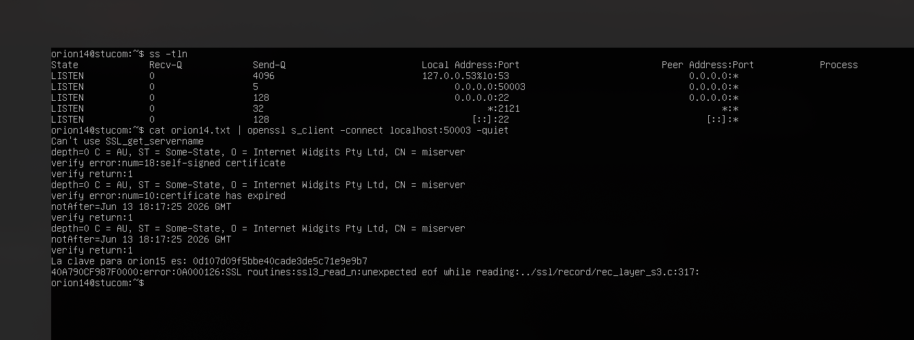

### Flag 16

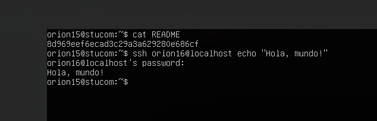

### Flag 17

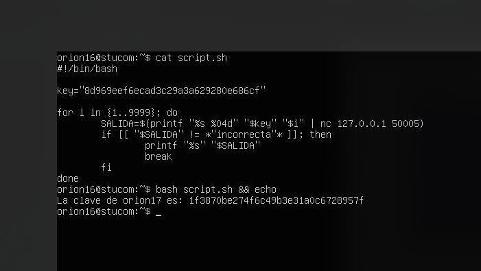

### Flag 18

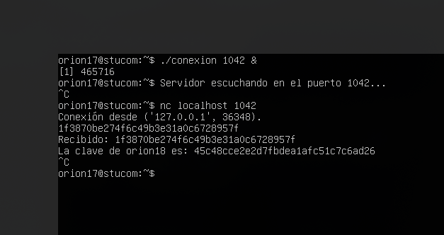

### Flag 19

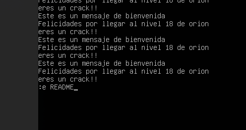
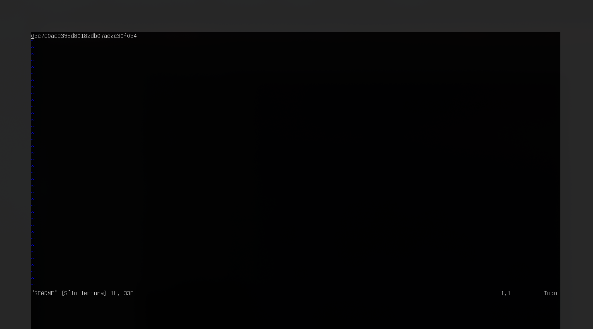

### SCT

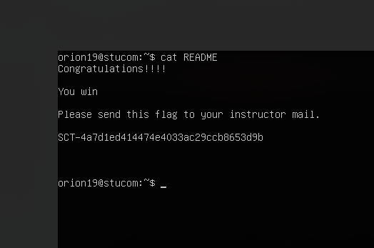
